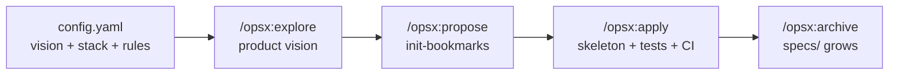

# Bookmarks · Scenario 1: SDD from zero (greenfield)

This branch family shows **spec-driven development on an empty repo**. There is no code
yet, only the product vision and the rules the agents follow. The first change is a
*walking skeleton*; the specs grow from there.



| Branch | What it contains |
| --- | --- |
| `greenfield/start` | Only `README.md`, `CLAUDE.md`, `.claude/` (6 sub-agents, `/opsx:*`), `openspec/config.yaml` with the vision and stack. No `apps/`. |
| `greenfield/after-propose` | + `openspec/changes/init-bookmarks/` (proposal, 2 specs, design with scaffold decisions, tasks). |
| `greenfield/after-apply` | + `apps/api` (Go, `GET`/`POST /api/bookmarks`), `apps/web` (React `BookmarkList`), unit tests, e2e, CI. |

## Run it

```bash
git switch -c gf-live origin/greenfield/start
claude
```

```text
/opsx:explore Read openspec/config.yaml. What is the smallest first release of Bookmarks that proves the stack end to end?
/opsx:propose init-bookmarks
/clear
/opsx:apply init-bookmarks
```

Stuck? `git switch -c gf-live origin/greenfield/after-propose` (or `after-apply`).

## What is different from the other scenarios

- **`context` carries the product vision and the stack decision**, because there is no code for the agent to read.
- **The first proposal is a walking skeleton**: one read, one write, UI, tests, CI, nothing more. The vision is listed under *Deferred*.
- **design.md adds `## Scaffold decisions`** (module names, ports, scripts, CI jobs) so every later change follows them.
- Ownership in apply stage 1 includes scaffolding (`go.mod`, `package.json`, Vite config); CI is created by the integration-test-engineer in stage 3.

Other scenarios in this repo: `integration/*` (new feature that must call an existing system) and
`demo/*` (continuing an existing product: baseline first, then deltas). See the main branch README.

Presenter: Ihsan Arif Rahman · [santekno.com](https://santekno.com)
