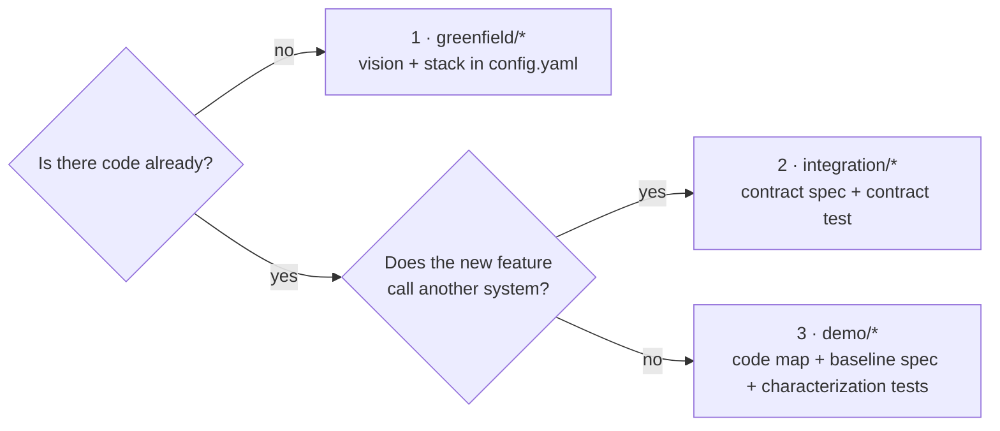

# Taskboard · OpenSpec + Claude Code sub-agents demo

Workshop repo for **Spec-Driven Development with OpenSpec**. It covers the three
ways a team starts with SDD, each as runnable branches:

| Scenario | Branches | Example |
| --- | --- | --- |
| 1. From zero (greenfield) | `greenfield/start`, `greenfield/after-propose`, `greenfield/after-apply` | New `bookmarks-app`: walking skeleton first |
| 2. From zero, integrating an existing system | `integration/start`, `integration/after-propose`, `integration/after-apply` | Assign tasks to users from the existing `users-auth` service |
| 3. Continue an existing / legacy product | `demo/ready`, `demo/mapped`, `demo/baseline`, `demo/after-propose`, `demo/after-apply`, `demo/after-archive` | Taskboard: **map + baseline first**, then the `add-task-list` delta |



The live demo runs scenario 3. One small change (`add-task-list`) goes from an
idea to a merged PR, built by six Claude Code sub-agents working as a pipeline:

| Sub-agent | Job | Default model |
| --- | --- | --- |
| product-manager | Explore options, write proposal, specs, design, tasks | opus |
| backend-engineer | Go API in `apps/api` | sonnet |
| frontend-engineer | React UI in `apps/web/src` | sonnet |
| test-engineer | Unit tests, one per spec scenario | sonnet |
| integration-test-engineer | Playwright e2e across the real API and browser | sonnet |
| qa-engineer | Read-only gate: `SHIP` or `DO-NOT-SHIP` | opus |

The app is deliberately tiny: a Go 1.22+ `net/http` API (port 8080) and a
React + Vite web app (port 5173, proxies `/api`). `main` only has a health
check and a home page: that is the "existing product". Before any feature it is
**mapped** (`docs/legacy-map.md`: structure, flows, risks) and **baselined** (its current
behavior becomes specs and characterization tests).

## Before the demo

Requirements: Node.js ≥ 22.12, Go ≥ 1.22, Git, GitHub CLI (logged in),
Claude Code (logged in), OpenSpec 1.16.x.

```bash
npm install -g @fission-ai/openspec@latest
git clone https://github.com/santekno/openspec-taskboard-demo.git
cd openspec-taskboard-demo
bash scripts/preflight.sh                  # tools, gh login, model-routing env
(cd apps/web && npm ci && npx playwright install chromium)
bash scripts/check.sh                       # go test, vitest, typecheck, e2e
bash scripts/dev.sh                         # run the app: web :5173, API :8080
```

The demo pushes branches, opens PRs, and merges into `main`, so run it in **your
own copy**, not in this repo. One command creates it (private by default) with
`main` and all `demo/*`, `greenfield/*`, and `integration/*` branches, and keeps this repo as `upstream`:

```bash
bash scripts/make-workspace.sh taskboard-demo        # add --public to make it public
```

Make a fresh copy (another name) for each rehearsal, so the live run starts from a clean `main`.

Optional, to stop permission prompts during the live run (machine-only, git-ignored):

```bash
mkdir -p .claude && cp scripts/settings.local.example.json .claude/settings.local.json
```

`CLAUDE_CODE_SUBAGENT_MODEL` must be **unset**, otherwise it overrides every
agent's model and the routing below does nothing.

## Run the app

One command starts everything and stops everything on Ctrl+C:

```bash
bash scripts/dev.sh
```

| Process | Port | Started when |
| --- | --- | --- |
| Go API (`go run .` in `apps/api`) | 8080 | always |
| Web (`npm run dev` in `apps/web`, Vite proxies `/api` to 8080) | 5173 | always |
| users-auth (`go run .` in `apps/users-auth`) | 8081 | `integration/*` branches |

Open http://localhost:5173. The script runs `npm ci` the first time, refuses to start if a
port is busy, and prefixes logs with `[api]`, `[web]`, `[users-auth]`.

Separately, in two terminals:

```bash
cd apps/api && go run .      # API :8080 (main.go lives here; `go run .` builds the package)
cd apps/web && npm run dev   # web :5173
```

## Demo flow

| Step | What you run | Fallback branch |
| --- | --- | --- |
| 1. Init OpenSpec | `openspec init --tools claude` | |
| 2–3. Sub-agents + workflow | `bash scripts/setup-agents.sh` (CLAUDE.md, `openspec/config.yaml`, 6 agents) | `demo/ready` |
| 4a. Map the code (**required**) | `/opsx:propose map-taskboard` (docs-only, `skip_specs: true`) → `docs/legacy-map.md`, then `openspec archive map-taskboard --yes` | `demo/mapped` |
| 4b. Baseline (**required**) | `/opsx:propose baseline-taskboard` from the map's capability candidates, characterization tests, `openspec archive baseline-taskboard --yes` | `demo/baseline` |
| 5. Explore | `/opsx:explore I want users to see and add tasks on the Taskboard home page…` | |
| 6. Propose | `git switch -c feat/add-task-list` then `/opsx:propose add-task-list` | `demo/after-propose` |
| 7. Apply | `/clear` then `/opsx:apply add-task-list` (4 stages + QA loop) | `demo/after-apply` |
| 8. PR | The apply guidance ends with `gh pr create`; then `gh pr checks --watch` | |
| 9. Archive | `/opsx:archive add-task-list` on `chore/archive-add-task-list` | `demo/after-archive` |

Why step 4 is required: on an existing product nobody has written down how the code is
built, and `openspec/specs/` starts empty. **4a** is increment 1: a docs-only change that
writes `docs/legacy-map.md` (structure, entry points, components, one Mermaid diagram per
flow, dependencies, test gaps, risks and refactor candidates, capability candidates). It
is a living document: every later change updates it, and `config.yaml` tells agents to
read it first. It is also the input for refactor planning. **4b** turns the map's
capability candidates into specs. On an existing product `openspec/specs/` starts empty. Without
a baseline, the first proposal would describe old behavior as new and nobody could tell
what must stay the same. The baseline records **what the code does today** (not what it
should do) as `ADDED` specs, locks it with tests in separate files, and is archived before
any feature work. Every change after that is a pure delta.

If a live step stalls, jump to the next safe point and keep going:

```bash
git switch -c demo-live origin/demo/after-propose   # or demo/ready, demo/mapped, demo/baseline, demo/after-apply, demo/after-archive
```

Skipping ahead to `demo/after-apply` mid-demo? Push it as the PR branch: `git push -u origin demo-live:feat/add-task-list`, then `gh pr create --fill`.

What each fallback branch contains:

- `demo/ready`: `main` + `openspec init --tools claude` + `scripts/setup-agents.sh`.
- `demo/mapped`: + change `map-taskboard` archived (docs-only): `docs/legacy-map.md` and a `context` line pointing at it.
- `demo/baseline`: + change `baseline-taskboard` archived: `openspec/specs/api/health` and `openspec/specs/web/home` (as-is), `baseline_test.go` and `App.baseline.test.tsx`.
- `demo/after-propose`: + `openspec/changes/add-task-list/` (proposal, 2 delta specs, design with a Mermaid flow and file-change table, tasks tagged by agent). Passes `openspec validate --strict`.
- `demo/after-apply`: + reference implementation and tests (`GET`/`POST /api/tasks`, `TaskList` UI, unit tests, e2e), all tasks checked.
- `demo/after-archive`: change archived, `openspec/specs/api/tasks` and `openspec/specs/web/task-list` created (4 specs in total).

## Demo all three scenarios

All three are runnable. In one session, run scenario 3 live end to end and show the
other two as short demos from their branches:

| Block | Scenario | Live part | Jump to | Show |
| --- | --- | --- | --- | --- |
| Main (45–60 min) | 3 · legacy | steps 1–9 above | `demo/*` fallbacks | map, baseline, delta, pipeline, archive |
| Short (~10 min) | 1 · from zero | `/opsx:explore` + `/opsx:propose init-bookmarks` on `greenfield/start` | `greenfield/after-apply` | `bash scripts/check.sh`, the Scaffold decisions in design.md |
| Short (~10 min) | 2 · integration | `/opsx:propose add-task-assignee` on `integration/start` | `integration/after-apply` | contract test against users-auth, e2e across 3 processes |

## Scenario 1: from zero (`greenfield/*`)

An orphan branch family: no `apps/`, only `CLAUDE.md`, the 6 sub-agents, and a
`config.yaml` whose `context` holds the product vision and the stack decision.
The first change, `init-bookmarks`, is a walking skeleton (Go API + React page + tests + CI).
Its README has the exact prompts.

```bash
git switch -c gf-live origin/greenfield/start
```

## Scenario 2: integrate with an existing system (`integration/*`)

Starts from `demo/after-archive`. `integration/start` adds `apps/users-auth`, a stand-in
for the company's existing users and auth service (port 8081), and its contract
`contracts/users-auth.openapi.yaml`. Change `add-task-assignee` records that contract as
spec `ext/users-auth` (as-is, read-only), adds deltas to `api/tasks` and `web/task-list`,
and proves the integration with a **contract test** and an e2e across three processes.

```bash
git switch -c int-live origin/integration/start
(cd apps/users-auth && go run .)        # port 8081
curl localhost:8081/users/u-1           # {"id":"u-1","name":"Ayu Lestari",...}
```

## Model routing

Defaults live in each agent's frontmatter (`model:`). Before every dispatch the
main agent checks the triggers in `CLAUDE.md` and, if one matches, passes a
higher model for that single call only:

| Sub-agent | Escalate to | When |
| --- | --- | --- |
| product-manager | fable | proposal sent back twice, or 3+ capabilities |
| backend-engineer | opus | concurrency (`sync.Mutex`, goroutines, channels) or a repeated fix |
| frontend-engineer | opus | bug not reproduced, or a second loop |
| test-engineer | opus | not reproduced, or concurrency / `-race` tests |
| integration-test-engineer | opus | flaky e2e after one retry |
| qa-engineer | fable | high-risk proposal or diff |

In this change `design.md` uses `sync.Mutex`, so backend-engineer runs on Opus.

## Layout

```
apps/api/                  Go API (go vet, go test -race)
apps/web/                  React + Vite (typecheck, vitest, playwright)
.github/workflows/ci.yml   go-test, web-test, e2e
scripts/setup-agents.sh    writes CLAUDE.md, openspec/config.yaml, .claude/agents/*.md
scripts/dev.sh             run API + web (+ users-auth) with one command, Ctrl+C stops all
scripts/check.sh           every CI check locally (--no-e2e to skip Playwright)
scripts/preflight.sh       presenter-laptop checks
scripts/make-workspace.sh  your own GitHub copy with all demo/*, greenfield/*, integration/* branches
apps/users-auth/            (integration/* only) mock of the existing users-auth service
contracts/                  (integration/* only) users-auth OpenAPI contract
```

## Commands cheat sheet

```bash
openspec list                                  # active changes and task progress
openspec status --change add-task-list         # which artifacts are done
openspec validate add-task-list --strict       # validate one change
openspec instructions apply --change add-task-list --json   # what the agent receives
openspec validate --specs --strict             # after archive
```

Presenter: Ihsan Arif Rahman · [santekno.com](https://santekno.com)
