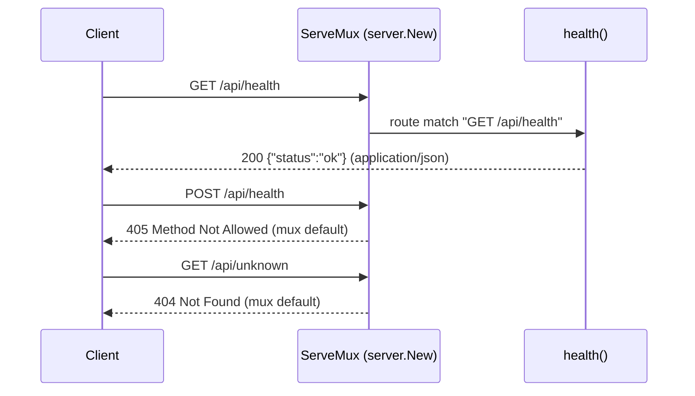
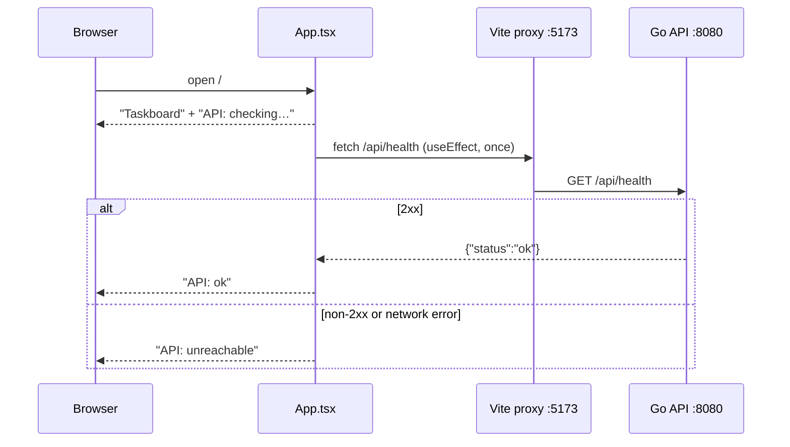
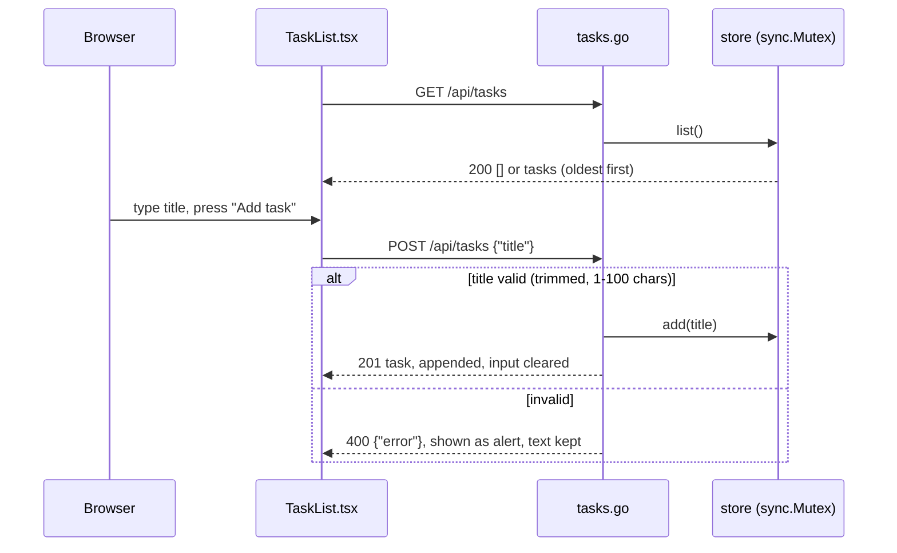

# Taskboard: code map

> Living document. Written by change `map-taskboard` (increment 1) before any spec existed.
> Update it in the same PR whenever a change alters structure or a flow.
> Every claim names the file it comes from.

## 1. Structure

```
apps/
  api/                         Go 1.22+, standard library only
    main.go                    entry point, listens on :8080 (PORT overrides)
    internal/server/server.go  routes + JSON helper
    internal/server/tasks.go   task store (sync.Mutex) + list/create handlers
    internal/server/server_test.go
  web/                         React 19 + Vite + TypeScript
    index.html, src/main.tsx   entry point, mounts <App/>
    src/App.tsx                the only page; renders <TaskList/>
    src/TaskList.tsx           task list, empty state, Add task form
    src/App.test.tsx           Vitest + Testing Library
    e2e/home.spec.ts           Playwright, starts API + Vite
    vite.config.ts             dev server :5173, proxies /api → :8080
.github/workflows/ci.yml       jobs: go-test, web-test, e2e
scripts/                       check.sh, preflight.sh, setup-agents.sh, make-workspace.sh
```

## 2. Entry points

| Entry | File | Notes |
| --- | --- | --- |
| API process | `apps/api/main.go` `main()` | `http.ListenAndServe(":8080", server.New())`, `PORT` env overrides |
| HTTP routes | `apps/api/internal/server/server.go` `New()` | one `http.ServeMux`; `GET /api/health`, `GET` and `POST /api/tasks` |
| Web app | `apps/web/src/main.tsx` | `createRoot(...).render(<App/>)` in `StrictMode` |
| Dev proxy | `apps/web/vite.config.ts` | `/api` → `http://localhost:8080` |

## 3. Components

| Component | File | Responsibility |
| --- | --- | --- |
| `server.New` | `server.go` | builds the mux, registers routes |
| `health` | `server.go` | answers `{"status":"ok"}` |
| `writeJSON` | `server.go` | sets `Content-Type: application/json`, writes status, encodes body (error ignored) |
| `App` | `App.tsx` | heading "Taskboard", the line "API: <status>", and `TaskList` |
| `store`, `listTasks`, `createTask` | `tasks.go` | in-memory tasks, title trimmed, 1–100 characters |
| `TaskList` | `TaskList.tsx` | loads tasks, shows "No tasks yet", posts new tasks, shows API errors as an alert |

## 4. Flows

### 4.1 Health check (API)



### 4.2 Home page load (web → API)



### 4.3 List and add tasks (added by `add-task-list`)



## 5. Dependencies

| Side | Runtime | Dev / test |
| --- | --- | --- |
| API | Go standard library only | `go test -race` |
| Web | react, react-dom | vite, vitest, @testing-library/*, @playwright/test, typescript |
| External systems | none | — |

## 6. Tests today

| Behavior | Covered by | Gap |
| --- | --- | --- |
| Health returns ok | `server_test.go` `TestHealth` | content type, 405, 404 not tested |
| Home shows "API: ok" | `App.test.tsx`, `e2e/home.spec.ts` | "checking…" and "unreachable" not tested |
| Baseline (health, home) | `baseline_test.go`, `App.baseline.test.tsx` | — |
| Tasks API and list | `tasks_test.go`, `TaskList.test.tsx`, `e2e/tasks.spec.ts` | — |

## 7. Risks and refactor candidates

| # | Observation | File | Suggested later change |
| --- | --- | --- | --- |
| R1 | `writeJSON` ignores the encode error | `server.go` | log it (refactor, no behavior change) |
| R2 | No request logging or middleware | `server.go` | add a logging middleware |
| R3 | No graceful shutdown or timeouts on the server | `main.go` | `http.Server` with timeouts + shutdown |
| R4 | `fetch` has no timeout; a hung API leaves "checking…" forever | `App.tsx` | abort after N seconds |
| R5 | Inline styles in `App.tsx` | `App.tsx` | move to CSS when the UI grows |
| R6 | Tasks live in memory and vanish on restart | `tasks.go` | persistence change (deferred in `add-task-list`) |

Each refactor is its own change with a **MODIFIED** delta (or `skip_specs` for pure refactors) after the baseline exists.

## 8. Capability candidates (input for the baseline)

| Capability | Covers | Flow |
| --- | --- | --- |
| `api/health` | health endpoint, 405 on wrong method, 404 on unknown path | 4.1 |
| `web/home` | heading, "API: checking… / ok / unreachable" | 4.2 |
| `api/tasks` | list and create tasks (spec from `add-task-list`) | 4.3 |
| `web/task-list` | list, empty state, add form (spec from `add-task-list`) | 4.3 |

Next change: `baseline-taskboard` writes these two as as-is specs and adds characterization tests for the gaps in section 6.
