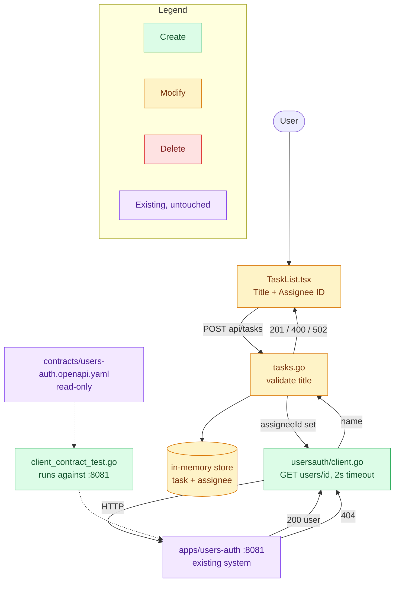

# Design

## Flow

## File changes

| Path | Action | Owner agent | Why |
| --- | --- | --- | --- |
| `apps/api/internal/usersauth/client.go` | Create | backend-engineer | Typed client: `GetUser`, `ErrNotFound`, `ErrUnavailable`, 2 s timeout |
| `apps/api/internal/server/tasks.go` | Modify | backend-engineer | Optional `assigneeId`, lookup before create, `assignee` in JSON |
| `apps/api/internal/server/server.go` | Modify | backend-engineer | `NewWith(users)`; `New()` reads `USERS_AUTH_URL` |
| `apps/web/src/TaskList.tsx` | Modify | frontend-engineer | Assignee ID input, "Assigned to" text |
| `apps/api/internal/usersauth/client_test.go` | Create | test-engineer | Client against an httptest fake built from the contract examples |
| `apps/api/internal/server/assignee_test.go` | Create | test-engineer | Known, unknown, down, and no-assignee scenarios with a fake lookup |
| `apps/web/src/TaskList.test.tsx` | Modify | test-engineer | Assignee input and mixed list |
| `apps/api/internal/usersauth/client_contract_test.go` | Create | integration-test-engineer | Same client against the running users-auth (skips without `USERS_AUTH_URL`) |
| `apps/web/playwright.config.ts` | Modify | integration-test-engineer | Third web server: users-auth on :8081 |
| `apps/web/e2e/assignee.spec.ts` | Create | integration-test-engineer | Assign to u-1, unknown id error |
| `.github/workflows/ci.yml`, `scripts/check.sh` | Modify | integration-test-engineer | `contract` job; check.sh runs the contract test too |
| `apps/users-auth/**`, `contracts/**` | None | — | Owned by another team; read-only for this change |
| `docs/legacy-map.md` | Modify | main agent | External system users-auth, flow 4.4, tests, risk R7 |
| None | Delete | — | Nothing is removed |

## Decisions

- **Contract first.** `ext/users-auth` is written from `contracts/users-auth.openapi.yaml` before any code. If the contract test fails, the integration is wrong, not users-auth.
- API contract:
  - `POST /api/tasks` body `{"title": "...", "assigneeId": "u-1"}` → 201 `{"id":1,"title":"...","done":false,"assignee":{"id":"u-1","name":"Ayu Lestari"}}`
  - unknown assignee → 400 `{"error":"assignee not found"}`; users-auth error or timeout → 502 `{"error":"users-auth unavailable"}`
  - `assignee` is omitted when not set; `GET /api/tasks` returns it as stored (no lookup on read).
- Client: `usersauth.Client{BaseURL, HTTP *http.Client{Timeout: 2s}}`; the server depends on a one-method interface `UserLookup` so tests inject a fake.
- Config: `USERS_AUTH_URL`, default `http://localhost:8081`.
- The name is copied at create time (snapshot). Renames in users-auth are not reflected; accepted for now.

## Risks / Trade-offs

- users-auth outage blocks only assigned task creation, never the list or unassigned tasks.
- Contract drift: caught by the contract job in CI, which runs the client against the service.
- Stale names (snapshot) are deferred to a caching / refresh change.
