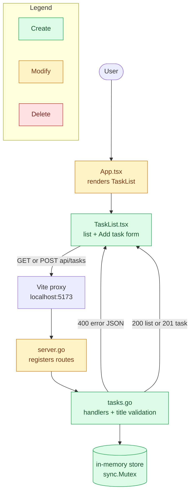

# Design

## Flow

## File changes

| Path | Action | Owner agent | Why |
| --- | --- | --- | --- |
| `apps/api/internal/server/tasks.go` | Create | backend-engineer | Task store, list and create handlers, title validation |
| `apps/api/internal/server/server.go` | Modify | backend-engineer | Register `GET` and `POST /api/tasks` |
| `apps/web/src/TaskList.tsx` | Create | frontend-engineer | Task list, empty state, Add task form, error alert |
| `apps/web/src/App.tsx` | Modify | frontend-engineer | Render `TaskList` under the health status |
| `apps/api/internal/server/tasks_test.go` | Create | test-engineer | One test per api/tasks scenario |
| `apps/web/src/TaskList.test.tsx` | Create | test-engineer | One test per web/task-list scenario |
| `apps/web/src/App.test.tsx` | Modify | test-engineer | Stub the new tasks request |
| `apps/web/e2e/tasks.spec.ts` | Create | integration-test-engineer | Add-task and empty-title journeys |
| None | Delete | — | Nothing is removed |

## Context

The API is a Go `net/http` server with routes in `internal/server`. The web app is React + Vite and proxies `/api` to port 8080. There is no database.

## Goals / Non-Goals

**Goals:**
- A small, testable task API and a usable list + form on the home page.

**Non-Goals:**
- Persistence, done/delete, pagination, auth.

## Decisions

- API contract:
  - `GET /api/tasks` → 200 `[{"id": 1, "title": "Buy milk", "done": false}]`
  - `POST /api/tasks` body `{"title": "..."}` → 201 task; 400 `{"error": "..."}` for invalid JSON or title
- Store: an in-memory slice guarded by `sync.Mutex`, ids from a counter. `server.New()` creates a fresh store, so each test gets clean state.
- Title rules: trim spaces; required; at most 100 characters (counted in runes).
- UI: one `TaskList` component rendered by `App.tsx`; append the created task from the 201 response instead of refetching.

## Risks / Trade-offs

- Data is lost on restart (accepted for this change; persistence is deferred).
