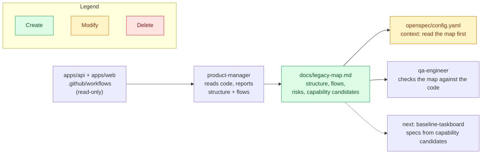

# Design

## Flow

## File changes

| Path | Action | Owner agent | Why |
| --- | --- | --- | --- |
| `docs/legacy-map.md` | Create | product-manager (report) → main agent (writes) | The shared map of the code as it is |
| `openspec/config.yaml` | Modify | main agent | `context` tells agents to read the map first |
| Application code, tests, specs | None | — | A map never changes behavior |
| None | Delete | — | Nothing is removed |

## Decisions

- **Map, not specs.** The map describes structure and flows in prose and diagrams; behavior goes into specs in the baseline change. Mixing them makes both stale.
- **Living document.** `docs/legacy-map.md` is updated whenever a change alters structure or a flow; it is not archived.
- **Every claim points at a file.** Each component and flow names the file and function it comes from, so the map can be checked.
- Fixed sections: Structure, Entry points, Components, Flows, Dependencies, Tests, Risks and refactor candidates, Capability candidates.
