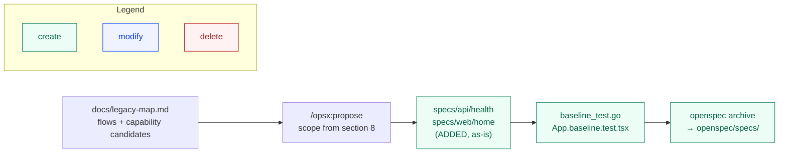

# Design: Baseline the existing Taskboard

## Flow

## File changes

| Path | Action | Owner agent | Why |
| --- | --- | --- | --- |
| `openspec/changes/baseline-taskboard/**` | Create | product-manager | Proposal and as-is specs |
| `apps/api/internal/server/baseline_test.go` | Create | test-engineer | Lock health, 405, and 404 behavior |
| `apps/web/src/App.baseline.test.tsx` | Create | test-engineer | Lock checking / ok / unreachable states |
| Application code | None | — | A baseline never changes behavior |
| Delete | None | — | Nothing is removed |

## Decisions

- **Specs describe what the code does, not what it should do.** If a test written from the spec fails, the spec is wrong, not the code.
- **Characterization tests live in their own files** so the feature changes that follow can edit `server_test.go` and `App.test.tsx` without touching the baseline.
- No API contract changes.
