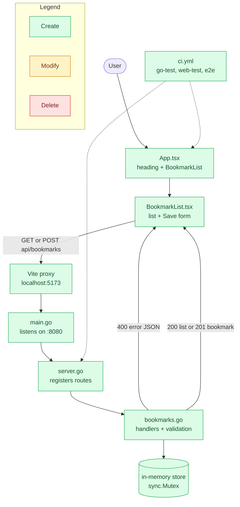

# Design

## Flow

Everything is new: this is the first change on an empty repo.

## File changes

| Path | Action | Owner agent | Why |
| --- | --- | --- | --- |
| `apps/api/go.mod`, `apps/api/main.go` | Create | backend-engineer | Go module and HTTP listener on :8080 |
| `apps/api/internal/server/server.go` | Create | backend-engineer | Route registration, health, JSON helper |
| `apps/api/internal/server/bookmarks.go` | Create | backend-engineer | Store, list and save handlers, validation |
| `apps/web/package.json`, `package-lock.json`, `index.html`, `vite.config.ts`, `tsconfig.json` | Create | frontend-engineer | Vite + React + TypeScript scaffold, `/api` proxy |
| `apps/web/src/main.tsx`, `App.tsx`, `BookmarkList.tsx` | Create | frontend-engineer | Page, list, empty state, Save form, error alert |
| `apps/api/internal/server/*_test.go` | Create | test-engineer | One test per api/bookmarks scenario |
| `apps/web/src/setupTests.ts`, `*.test.tsx` | Create | test-engineer | One test per web/bookmark-list scenario |
| `apps/web/playwright.config.ts`, `apps/web/e2e/bookmarks.spec.ts` | Create | integration-test-engineer | Save and invalid-URL journeys against both servers |
| `.github/workflows/ci.yml` | Create | integration-test-engineer | go-test, web-test, e2e jobs |
| None | Delete | — | Nothing is removed |

## Scaffold decisions

- Go module `example.com/bookmarks/api`; packages under `internal/`; standard library only.
- Ports: API 8080, web 5173 with `strictPort`; Vite proxies `/api` to 8080.
- npm scripts: `dev`, `build`, `typecheck`, `test` (Vitest, jsdom, globals), `e2e` (Playwright).
- CI: one workflow, three jobs (go-test, web-test, e2e), Node 22 and Go 1.22+.
- `scripts/check.sh` runs the same checks locally; later changes keep it green.

## Decisions

- API contract:
  - `GET /api/bookmarks` → 200 `[{"id": 2, "url": "https://go.dev", "title": "Go"}]` (newest first)
  - `POST /api/bookmarks` body `{"url": "...", "title": "..."}` → 201 bookmark; 400 `{"error": "..."}` for invalid JSON, URL, or title
  - `GET /api/health` → 200 `{"status":"ok"}`
- URL rule: `net/url.ParseRequestURI`, scheme `http` or `https`, non-empty host.
- Title rule: trim spaces; required; at most 120 characters (runes).
- Store: slice guarded by `sync.Mutex`; ids from a counter; `server.New()` creates a fresh store per test.
- UI: prepend the 201 response instead of refetching.

## Risks / Trade-offs

- Data is lost on restart (accepted; persistence is deferred).
- The skeleton fixes conventions early; changing them later means a dedicated change.
